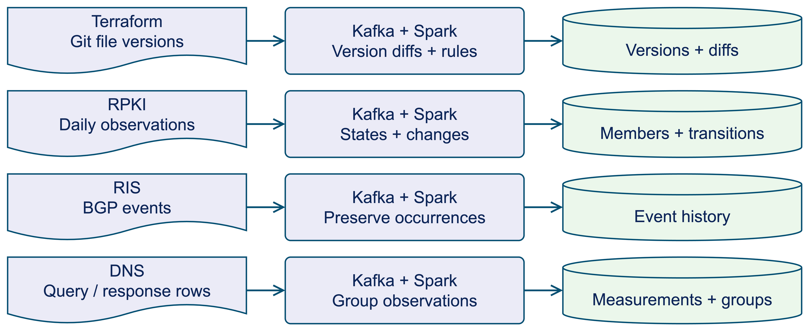
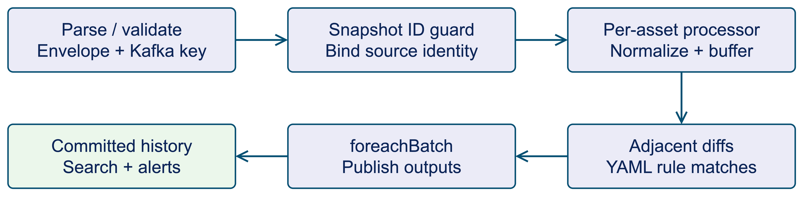
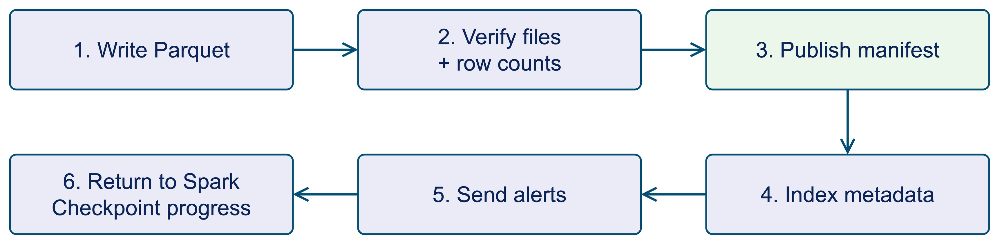
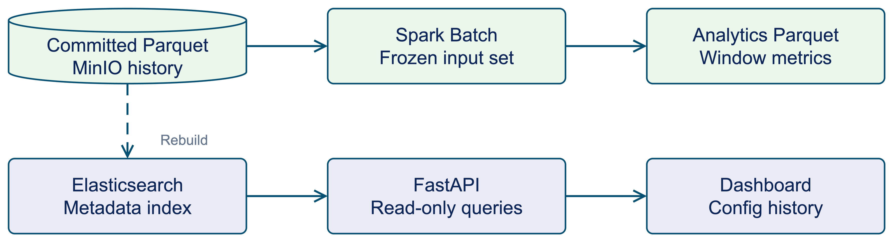

# ConfigStream

**Scalable Configuration Change Storage and Streaming Analytics**

[](https://github.com/kongwoang/ConfigStream/actions/workflows/ci.yml)


Store configuration history, identify changes, and explore infrastructure data over time.
Built for the **Big Data Storage & Processing** course, ConfigStream combines Kafka,
Spark and a Parquet data lake with a read-only API and research dashboard,
with a demonstrated single-node Kubernetes deployment.

[Architecture](#architecture) · [Kubernetes](#kubernetes-deployment) · [Quick start](#quick-start) · [Datasets](#datasets) ·
[Recorded results](#selected-results) · [Dashboard](#dashboard) · [Documentation](docs/README.md) ·
[Checkpoint slides](docs/presentations/checkpoint-2026-10-26/main.pdf)

## Architecture


The diagram shows the **configuration-history path**. Kafka transports snapshots;
Spark validates source identity, buffers versions per asset, computes adjacent diffs
and evaluates rules. MinIO retains committed Parquet history. Elasticsearch and
FastAPI serve a rebuildable metadata projection, while Spark batch reads the lake
for historical analytics.

| Layer | Technology | Responsibility |
| --- | --- | --- |
| Ingestion | Python, Kafka | Source adapters, asset-keyed records and replay |
| Processing | Spark Structured Streaming | Snapshot identity checks, per-asset version state, normalization, diffs and rules |
| Historical storage | MinIO, Snappy Parquet | Raw deliveries, typed outputs and verified commit manifests |
| Batch analytics | Spark DataFrames / SQL | Change frequency, alert trends and prior-window anomaly flags |
| Configuration serving | Elasticsearch, FastAPI | Derived metadata indexes, asset/time filters and a read-only API |
| Presentation | Next.js, React | Configuration history and accepted cross-domain research results |
| Deployment | Kubernetes / K3s | Separate Spark driver/executor pods, services and persistent volumes |

### Four data domains



Each domain has its own identity, schema and temporal logic. Adjacent file diffs,
set transitions, routing occurrences and DNS observations are not interchangeable.

<details>
<summary><strong>Inside Spark: identity checks and version state</strong></summary>



The first stateful stage groups by `snapshot_id` to validate source identity and
handle retries/conflicts. The second groups by `asset_id`, normalizes content and
buffers versions. Only adjacent available versions produce new logical diffs;
event-time policies and a version cap bound retained state. Raw fetched Kafka
records have a separate archival branch.

</details>

<details>
<summary><strong>Commit protocol: make complete history readable</strong></summary>



In the lake-enabled path, files and counts are verified before the commit manifest
is published. Exact batch retries verify and reuse the committed history. Search
indexing and alert publication follow; Spark then advances its checkpoint progress.
These sinks do not form one atomic transaction, and physical alert duplicates are
possible after a retry.

</details>

<details>
<summary><strong>Two read paths: batch analytics and configuration queries</strong></summary>



Batch analytics freezes its input manifest set and reads committed Parquet.
Elasticsearch is a derived metadata index, normally updated after streaming lake
commits. The dashed path is an explicit index rebuild. FastAPI serves metadata;
research dashboard pages use a separate accepted evidence bundle.

</details>

These diagrams are shared with the maintained checkpoint slides. Read the
[detailed architecture](docs/architecture.md) and [data model](docs/data-model.md);
[editable diagram sources](docs/presentations/checkpoint-2026-10-26/figs/) accompany the images.

### Kubernetes deployment

The teaching stack has run on **one local ARM64 K3s node**. Spark launches native
**driver and executor pods separately** for streaming and batch applications.

| Namespace | Deployed components |
| --- | --- |
| `cs-infra` | Strimzi/Kafka (replication factor 1), MinIO and persistent storage |
| `cs-processing` | Fixture producers, Spark drivers/executors, checkpoint/evidence PVC |
| `cs-app` | Elasticsearch, read-only FastAPI and the Nginx-served static dashboard |

Services provide internal access; local port-forwarding exposes the demo.
Persistent volumes support the tested pod-restart recovery. This single-node,
local-path setup does not establish node-loss durability or multi-node HA.

[Manifests and infrastructure](infra/k8s/README.md) ·
[Pipeline deployment](docs/kubernetes-deployment.md) ·
[Dashboard deployment](docs/phase20v-kubernetes-deployment.md) ·
[Recovery runbook](docs/kubernetes-recovery.md)

## Selected results

**The pipeline has completed recorded end-to-end runs**, followed by batch analysis
and a Kubernetes fixture/demo campaign. Each result below links to its executed scope.

| Completed check | Recorded result | Evidence |
| --- | --- | --- |
| TerraDS → Kafka → Spark → MinIO | **10,188 snapshots → 3,683 adjacent diffs**; exact history match, no missing/extra or duplicate identities; final measured lag **0** | [Replay](docs/phase12-acceptance.md) |
| Historical Spark batch | **8 jobs completed**; frequency totals match the replay; **6,505** asset summaries | [Batch results](docs/phase12-acceptance.md#historical-analytics-and-serving-compatibility) |
| Kubernetes and recovery | Native driver/executor execution; **2 logical versions / 1 diff** survive replay; pod replacement and commit-before-checkpoint recovery passed | [Deployment and recovery](docs/phase20-k8s-acceptance.md) |
| API and dashboard | Deployed UI queried the real API: **2 versions / 1 adjacent diff**, with a successful fresh readiness request during rehearsal | [Dashboard acceptance](docs/phase20v-acceptance.md) |
| RPKI representation experiment | Analytical storage **47.76 → 3.56 MB (−92.6%)**; reconstruction **6.73 → 6.88 s**, exact outputs. Saving across all accounted local files: **17.5%** | [Measurements](docs/phase20-storage-query.md) |

The RPKI figures cover 14 daily states and repeated warm queries, excluding deployed
Kafka/checkpoint costs. [Comparison charts](docs/presentations/checkpoint-2026-10-26/figs/rpki-storage-query.png).
These are completed runs at their recorded revisions, not a claim that the current
stack is online or all project goals are finished. **The latest integrity image
still needs a completed Kubernetes recovery rerun**; scalability and HA remain open.
[Current status](docs/architecture.md#scope-and-status).

## What it does

A current configuration file shows the latest state. Understanding how that state
changed requires a history that survives retries, late arrivals and restarts.
ConfigStream implements that workflow and evaluates how different kinds of
infrastructure history should be represented.

- **Track configuration versions.** Normalize supported text, compare adjacent
  versions per asset, and apply YAML rules to detect changes such as disabled logging.
- **Process four kinds of temporal data.** Keep Terraform file versions, RPKI
  observed states, RIS event occurrences and DNS measurements distinct.
- **Keep queryable history.** Publish committed Parquet datasets to MinIO, run
  historical analytics, and serve configuration metadata through Elasticsearch and FastAPI.
- **Inspect the evidence.** Explore accepted datasets, storage comparisons and
  recorded operational results in the dashboard.

## Quick start

### Run the processing demo

Requires Git, Make, a Python installation with `venv` and `pip`, and internet access
for initial setup. The demo runs without Docker or external services.

```sh
git clone https://github.com/kongwoang/ConfigStream.git
cd ConfigStream
make setup
make processing-demo
```

Setup uses the committed `uv.lock`, provisions Python 3.12 when needed, and keeps
its environment and caches inside the repository. It does not download research datasets.

The demo compares two versions of a router configuration and prints normalized,
masked content and a structured diff. Its changes include:

```diff
- logging enabled
- telnet disabled
+ logging disabled
+ telnet enabled
```

Use `make generator` to produce a small deterministic JSONL workload and
`make test` to run the unit suite.

### Preview the dashboard

From the repository root, with Node.js 24 and npm installed:

```sh
cd frontend
npm ci
npm run build
node tests/serve.mjs
```

Open **http://127.0.0.1:13000**. Research views use the checked-in evidence bundle.
Configuration history and readiness need the API at `127.0.0.1:18800`; without it,
those views report that the backend is unavailable. See the
[frontend guide](frontend/README.md) and [integrated demo](docs/phase20v-demo-script.md).

For the full pipeline, choose the [local service setup](docs/README.md#run-the-system)
or the [Kubernetes deployment](docs/kubernetes-deployment.md). The host-local
Kafka/storage setup uses Docker Compose; host-local Spark also requires Java 21.

## Datasets

The project includes controlled synthetic inputs and four accepted real-source workloads.
Counts below describe selected, validated scopes; their units are different.

| Dataset | What a record means | Accepted scope |
| --- | --- | --- |
| **Terraform / TerraDS** | A version of an infrastructure-code file | **10,188 versions**, 6,505 file histories, 375 repositories |
| **RPKI** | Membership in an observed route-authorization state | **14 complete daily observations**, `ripencc.tal`, 1–14 Sep 2026 |
| **RIS** | A native BGP event occurrence | **4,725,156 occurrences**, `rrc00`, 1 Sep 2026, 00:00–01:00 UTC |
| **DNS** | A recorded query/response measurement | **2,234,863 measurements**, two selected `.li` source objects, 1–2 Sep 2026 |

Git revisions do not establish deployments. Observed RPKI states, BGP updates and
DNS measurements retain their own coverage and interpretation limits. Source
manifests and validation receipts are versioned; large source files stay outside Git.
See the [dataset guides](docs/README.md#data-and-domain-contracts) and
[machine-readable evidence catalog](frontend/public/research/v1/catalog.json).

## Dashboard


The overview presents accepted dataset scopes and recorded research results.
Configuration history supports asset/date filters and version, diff and alert
metadata through the API. Operations separates recorded deployment metrics from
an explicitly requested API readiness check; the screenshot is not a current
health or live-ingestion claim.

[Run the frontend](frontend/README.md) · [Integrated walkthrough](docs/phase20v-demo-script.md) ·
[Checkpoint slides with Vietnamese presenter notes](docs/presentations/checkpoint-2026-10-26/README.md)

## Development

```sh
make check           # Ruff lint, formatting checks and unit tests
make api-setup       # Install the optional API/search dependencies
make api-test        # API tests without external services
```

Spark, infrastructure and frontend checks have their own setup requirements in the
[development guides](docs/README.md#development-and-validation).
[CI](.github/workflows/ci.yml) checks Python, local Spark transformations,
Kubernetes manifests and the dashboard, including browser fixtures.

| Directory | Contents |
| --- | --- |
| `schemas/`, `generator/`, `processing/` | Contracts, controlled inputs, normalization, diffs and rules |
| `messaging/`, `spark/` | Kafka transport and domain-specific Spark jobs |
| `lake/`, `analytics/`, `search/`, `api/` | Storage, historical queries and configuration serving |
| `workloads/`, `benchmarks/` | Source preparation, validation receipts and experiments |
| `frontend/`, `infra/` | Dashboard and deployment configuration |
| `tests/`, `docs/` | Automated checks, setup guides, methodology and presentations |

For changes, open a focused pull request describing the behavior and validation.
Run the relevant checks and keep generated datasets, credentials, service state,
virtual environments and `node_modules/` out of commits.

## Next steps

- Rehearse the integrated demo and repeat recovery validation on the latest image.
- Extend matched storage/query comparisons beyond the completed RPKI scope.
- Measure paced replay and distributed scaling before making capacity claims.

Completed milestones and detailed acceptance records live in the
[project history](docs/project-history.md). Browse the
[documentation index](docs/README.md) for setup, operations and research material.

## Team and acknowledgments

**Group 4 · Big Data Storage & Processing**

Phạm Công Hoàng · Lê Tiến Hợp · Mai Vũ Hoàng · Nguyễn Đức Dũng

The project uses TerraDS, RIPE NCC/RIS and OpenINTEL source material. Dataset
attribution and usage terms are recorded in the [data guides](docs/README.md#data-and-domain-contracts);
frontend dependency notices are in [THIRD_PARTY_NOTICES.md](frontend/THIRD_PARTY_NOTICES.md).
