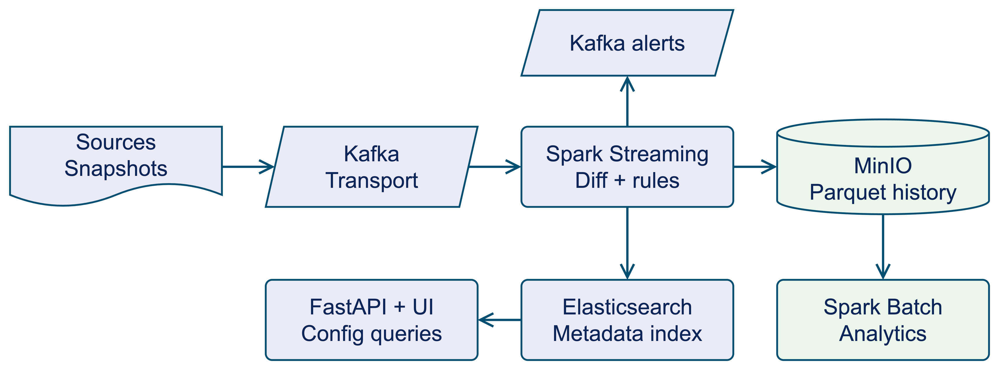
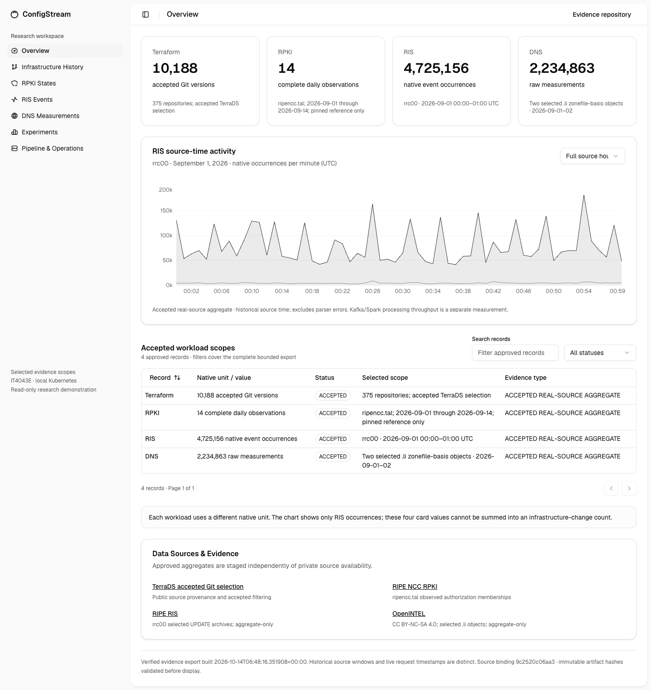

# ConfigStream

**Scalable Configuration Change Storage and Streaming Analytics**

[](https://github.com/kongwoang/ConfigStream/actions/workflows/ci.yml)


Store configuration history, identify changes, and explore infrastructure data over time.
Built for the **Big Data Storage & Processing** course, ConfigStream combines Kafka,
Spark and a Parquet data lake with a read-only API and research dashboard.

[Architecture](#architecture) · [Quick start](#quick-start) · [Datasets](#datasets) ·
[Results](#selected-results) · [Dashboard](#dashboard) · [Documentation](docs/README.md) ·
[Checkpoint slides](docs/presentations/checkpoint-2026-10-26/main.pdf)

## Architecture



The diagram shows the **configuration-history path**. Kafka transports snapshots;
Spark validates source identity, buffers versions per asset, computes adjacent diffs
and evaluates rules. MinIO retains committed Parquet history. Elasticsearch and
FastAPI serve a rebuildable metadata projection, while Spark batch reads the lake
for historical analytics.

| Layer | Technology | Responsibility |
| --- | --- | --- |
| Ingestion | Python, Kafka | Source adapters, asset-keyed records and replay |
| Processing | Spark Structured Streaming | Snapshot identity checks, per-asset version state, normalization, diffs and rules |
| Historical storage | MinIO, Snappy Parquet | Raw deliveries, typed outputs and verified commit manifests |
| Batch analytics | Spark DataFrames / SQL | Change frequency, alert trends and prior-window anomaly flags |
| Configuration serving | Elasticsearch, FastAPI | Derived metadata indexes, asset/time filters and a read-only API |
| Presentation | Next.js, React | Configuration history and accepted cross-domain research results |

**Publication order:** write and verify Parquet → publish the lake manifest →
index metadata → send alerts → return to Spark for progress checkpointing.
Readers use manifest-declared files. Exact batch retries verify and reuse committed
history; publication across MinIO, Elasticsearch and Kafka is not atomic.

Terraform, RPKI, RIS and DNS share infrastructure but retain separate schemas,
identities and processing logic. See the [four domain paths](docs/presentations/checkpoint-2026-10-26/figs/four-paths.png),
[detailed architecture](docs/architecture.md), [data model](docs/data-model.md) and
[editable architecture diagram](docs/presentations/checkpoint-2026-10-26/figs/config-path.drawio).

## What it does

A current configuration file shows the latest state. Understanding how that state
changed requires a history that survives retries, late arrivals and restarts.
ConfigStream implements that workflow and evaluates how different kinds of
infrastructure history should be represented.

- **Track configuration versions.** Normalize supported text, compare adjacent
  versions per asset, and apply YAML rules to detect changes such as disabled logging.
- **Process four kinds of temporal data.** Keep Terraform file versions, RPKI
  observed states, RIS event occurrences and DNS measurements distinct.
- **Keep queryable history.** Publish committed Parquet datasets to MinIO, run
  historical analytics, and serve configuration metadata through Elasticsearch and FastAPI.
- **Inspect the evidence.** Explore accepted datasets, storage comparisons and
  recorded operational results in the dashboard.

## Quick start

### Run the processing demo

Requires Git, Make, a Python installation with `venv` and `pip`, and internet access
for initial setup. The demo runs without Docker or external services.

```sh
git clone https://github.com/kongwoang/ConfigStream.git
cd ConfigStream
make setup
make processing-demo
```

Setup uses the committed `uv.lock`, provisions Python 3.12 when needed, and keeps
its environment and caches inside the repository. It does not download research datasets.

The demo compares two versions of a router configuration and prints normalized,
masked content and a structured diff. Its changes include:

```diff
- logging enabled
- telnet disabled
+ logging disabled
+ telnet enabled
```

Use `make generator` to produce a small deterministic JSONL workload and
`make test` to run the unit suite.

### Preview the dashboard

From the repository root, with Node.js 24 and npm installed:

```sh
cd frontend
npm ci
npm run build
node tests/serve.mjs
```

Open **http://127.0.0.1:13000**. Research views use the checked-in evidence bundle.
Configuration history and readiness need the API at `127.0.0.1:18800`; without it,
those views report that the backend is unavailable. See the
[frontend guide](frontend/README.md) and [integrated demo](docs/phase20v-demo-script.md).

For the full pipeline, follow the [service setup guides](docs/README.md#run-the-system).
Kafka and storage use Docker Compose; Spark additionally requires Java 21.

## Datasets

The project includes controlled synthetic inputs and four accepted real-source workloads.
Counts below describe selected, validated scopes; their units are different.

| Dataset | What a record means | Accepted scope |
| --- | --- | --- |
| **Terraform / TerraDS** | A version of an infrastructure-code file | **10,188 versions**, 6,505 file histories, 375 repositories |
| **RPKI** | Membership in an observed route-authorization state | **14 complete daily observations**, `ripencc.tal`, 1–14 Sep 2026 |
| **RIS** | A native BGP event occurrence | **4,725,156 occurrences**, `rrc00`, 1 Sep 2026, 00:00–01:00 UTC |
| **DNS** | A recorded query/response measurement | **2,234,863 measurements**, two selected `.li` source objects, 1–2 Sep 2026 |

Git revisions do not establish deployments. Observed RPKI states, BGP updates and
DNS measurements retain their own coverage and interpretation limits. Source
manifests and validation receipts are versioned; large source files stay outside Git.
See the [dataset guides](docs/README.md#data-and-domain-contracts) and
[machine-readable evidence catalog](frontend/public/research/v1/catalog.json).

## Selected results

**Integrated processing:** a recorded local Terraform replay passed **10,188 snapshots**
through Kafka, Spark and MinIO and verified **3,683 adjacent diffs**.
[Replay evidence](docs/phase12-acceptance.md).

**Storage trade-off:** a matched local RPKI experiment reconstructed the same 14 daily
states using three layouts. All query outputs agreed exactly.

| Layout | Analytical storage | Reconstruct all 14 days | Accounted local files |
| --- | ---: | ---: | ---: |
| Full daily states | 47.76 MB | 6.73 s | 251.98 MB |
| Initial state + changes | **3.56 MB** | 6.88 s | **207.90 MB** |
| Initial state + changes + day-8 checkpoint | 6.95 MB | 6.76 s | 211.19 MB |

Storing the initial state and changes saved **92.6% of analytical bytes** with
similar reconstruction time. Including source archives, coordinate maps, metadata
and retained query scratch reduced the saving to **17.5% of accounted local files**.

Times are medians of three build-level medians, each with three warm query cycles.
MB means 1,000,000 bytes. This local representation experiment excludes deployed
Kafka/checkpoint costs and filesystem overhead. See the
[methodology and measurements](docs/phase20-storage-query.md) and
[comparison charts](docs/presentations/checkpoint-2026-10-26/figs/rpki-storage-query.png).

**Validation scope:** pipelines have recorded local runs, plus a single-node
Kubernetes deployment with fixture recovery tests. Distributed scalability and HA
remain unproven. The latest configuration-integrity changes still need a completed
Kubernetes recovery rerun; historical acceptance does not validate the newer image.
[Current architecture status](docs/architecture.md#scope-and-status).

## Dashboard



The overview presents accepted dataset scopes and recorded research results.
Configuration history supports asset/date filters and version, diff and alert
metadata through the API. Operations separates recorded deployment metrics from
an explicitly requested API readiness check; the screenshot is not a current
health or live-ingestion claim.

[Run the frontend](frontend/README.md) · [Integrated walkthrough](docs/phase20v-demo-script.md) ·
[Checkpoint slides with Vietnamese presenter notes](docs/presentations/checkpoint-2026-10-26/README.md)

## Development

```sh
make check           # Ruff lint, formatting checks and unit tests
make api-setup       # Install the optional API/search dependencies
make api-test        # API tests without external services
```

Spark, infrastructure and frontend checks have their own setup requirements in the
[development guides](docs/README.md#development-and-validation).
[CI](.github/workflows/ci.yml) checks Python, local Spark transformations,
Kubernetes manifests and the dashboard, including browser fixtures.

| Directory | Contents |
| --- | --- |
| `schemas/`, `generator/`, `processing/` | Contracts, controlled inputs, normalization, diffs and rules |
| `messaging/`, `spark/` | Kafka transport and domain-specific Spark jobs |
| `lake/`, `analytics/`, `search/`, `api/` | Storage, historical queries and configuration serving |
| `workloads/`, `benchmarks/` | Source preparation, validation receipts and experiments |
| `frontend/`, `infra/` | Dashboard and deployment configuration |
| `tests/`, `docs/` | Automated checks, setup guides, methodology and presentations |

For changes, open a focused pull request describing the behavior and validation.
Run the relevant checks and keep generated datasets, credentials, service state,
virtual environments and `node_modules/` out of commits.

## Next steps

- Rehearse the integrated demo and repeat recovery validation on the latest image.
- Extend matched storage/query comparisons beyond the completed RPKI scope.
- Measure paced replay and distributed scaling before making capacity claims.

Completed milestones and detailed acceptance records live in the
[project history](docs/project-history.md). Browse the
[documentation index](docs/README.md) for setup, operations and research material.

## Team and acknowledgments

**Group 4 · Big Data Storage & Processing**

Phạm Công Hoàng · Lê Tiến Hợp · Mai Vũ Hoàng · Nguyễn Đức Dũng

The project uses TerraDS, RIPE NCC/RIS and OpenINTEL source material. Dataset
attribution and usage terms are recorded in the [data guides](docs/README.md#data-and-domain-contracts);
frontend dependency notices are in [THIRD_PARTY_NOTICES.md](frontend/THIRD_PARTY_NOTICES.md).
