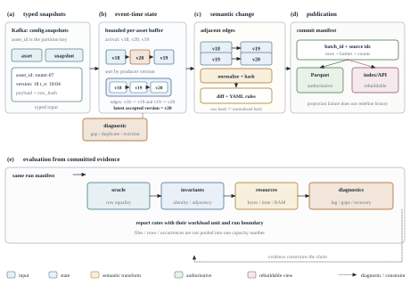

# Abstract

Configuration history is useful only when a recorded change can be related to a stable asset, a version, a source time, and a reproducible processing decision. In practice, configuration records arrive out of order, are retried, may be incomplete, and are often served through indexes that are easier to query than to audit. ConfigStream is a research and engineering platform for this setting. It combines versioned data contracts, Kafka ingestion, Spark Structured Streaming with event-time state, deterministic text normalization and adjacent-version diffing, committed Parquet history, rebuildable Elasticsearch projections, and a read-only API/dashboard boundary.

This paper describes the design and evaluates the implementation using three evidence layers: observed public configuration histories, controlled histories calibrated from those observations, and stress/replay workloads. The evaluation preserves the different semantics of file versions, complete state observations, uncertain measurements, and event occurrences rather than reducing them to one generic change stream. On the accepted TerraDS history replay, the system processed 10,188 snapshots and 3,683 adjacent pairs with exact replay checks and no alerts or diagnostics. A corrected matched processing campaign completed 27 exact fresh-process trials across RPKI, RIS, and DNS normalized projections. For the registered normalized core, direct Arrow writing was faster than the Spark batch and queued streaming variants in all three workloads, but this comparison excludes source parsing, production state finalization, and paced replay. The full rate-controlled streaming hypothesis was not run. These results support ConfigStream as a reproducible architecture evaluation, not as evidence of production-scale throughput, high availability, or end-to-end exactly-once delivery.

**Keywords:** configuration history; event-time processing; stream processing; Kafka; Spark Structured Streaming; data lake; replay; provenance; temporal evidence; reproducible systems evaluation.

# 1. Introduction

Infrastructure configuration is rarely consumed as a single current snapshot. Operators and auditors need to know which version was observed, when it was observed, what changed relative to the previous version, whether a missing interval is real or only unobserved, and whether an alert can be reconstructed after a restart. Those questions become harder when the input is a mixture of generated records, file histories, measurements, and event logs. A line that appears twice may be a retry, a second legitimate occurrence, or a repeated state. A missing file may indicate deletion, incomplete coverage, or a failed collector. Treating all of these cases as a generic “change event” makes downstream analytics look simple while silently changing their meaning.

The systems problem is therefore not merely to move configuration records through Kafka and Spark. It is to preserve the identity and temporal semantics that make a historical answer auditable. Event-time stream-processing systems already provide principled tools for out-of-order data, watermarks, and the trade-off between correctness, latency, and cost (Akidau et al., 2015). Kafka provides a replayable partitioned log for decoupled ingestion and consumption (Kreps et al., 2011), while Structured Streaming provides a declarative way to incrementalize relational computations and combine streaming with batch analysis (Armbrust et al., 2018). ConfigStream uses these established components, but the application-specific question is how to bind them to configuration identity and adjacent versions without confusing arrival order with version order.

This paper studies that question through a complete, testable pipeline. A source produces typed `Asset`, `ChangeEvent`, and `ConfigSnapshot` records. Kafka transports them with `asset_id` keys. Spark validates the snapshot stream, applies event-time watermarking and identity deduplication, stores a bounded version buffer per asset, pairs adjacent versions, and invokes deterministic normalization, diff, and rule logic. A lake-first output boundary writes raw provenance and typed processed records to MinIO/Parquet before optional search indexing and alert publication. Batch analytics read the committed lake; Elasticsearch and FastAPI expose safe metadata projections rather than becoming a second source of truth.

The paper asks three research questions.

* **RQ1 — evidence preservation:** Can typed identity, coverage and publication contracts preserve the declared logical history under retry, disorder and bounded failure?
* **RQ2 — representation cost:** How do authoritative history, canonical projections and rebuildable indexes trade storage cost against exact reconstruction and query cost?
* **RQ3 — processing policy:** How do workload shape and delivery policy affect the local cost and practical utility of batch and streaming processing?

The contributions are deliberately bounded.

1. We present a working, version-aware pipeline that connects data contracts, Kafka, native Spark state, deterministic configuration processing, committed Parquet history, and safe serving projections. The implementation boundary is explicit: the lake is authoritative and the search/API layer is rebuildable.
2. We define a semantics-aware evaluation protocol that keeps Terraform file histories, RPKI state observations, DNS measurements, and RIS event occurrences distinct. The protocol uses independent oracles, exact identity comparisons, completeness barriers, and explicit negative findings.
3. We report accepted replay and processing results from the repository, including the 10,188-snapshot TerraDS replay and the corrected 27-trial matched normalized-core campaign. We also record the full-rate and production-style comparisons that remain unexecuted.

The paper makes no claim that ConfigStream introduces a new messaging system, a new temporal database, or a new distributed algorithm. Its value is the integration of existing data-processing ideas with a conservative identity and evidence boundary, followed by an evaluation that does not hide failed or pending cells.

# 2. Related Work and Background

## 2.1. Batch and streaming data processing

MapReduce established a simple programming model for parallel processing over large datasets and moved partitioning, scheduling, communication, and retry logic out of application code (Dean and Ghemawat, 2004). Spark extended the cluster-processing model with reusable working sets and lineage-based recovery (Zaharia et al., 2010; Zaharia et al., 2012). These systems motivate ConfigStream's separation between a streaming path for incremental processing and a batch path for historical recomputation. The separation matters because a batch job can be the more appropriate reference when the input window is small, the source is complete, or the question requires a broad historical scan.

Kafka complements compute engines by retaining records in a partitioned log that can feed multiple consumers and support replay (Kreps et al., 2011). ConfigStream uses Kafka as an ingestion and experiment boundary rather than as an application database. Ordering is used only within a topic partition; cross-topic arrival order is not treated as a fact. This distinction is important for configuration records because an event and its snapshot are separate messages and may be observed by different consumers in different orders.

Structured Streaming provides the closest execution model to ConfigStream's live path. Its declarative API treats a streaming query as an incremental computation over an input table and supports integration with batch analysis (Armbrust et al., 2018). ConfigStream adds an application-specific state contract on top of that model: the unit of state is an asset, the retained sequence is bounded by policy, and a diff is emitted only for an adjacent version edge selected by `asset_id` and version, never by the previous Kafka row.

## 2.2. Event time, disorder, and temporal evidence

The Dataflow Model frames unbounded and out-of-order processing as a balance among correctness, latency, and cost rather than as a problem solved by sorting all input globally (Akidau et al., 2015). This perspective directly informs ConfigStream's use of `event_time`, watermarks, deduplication, bounded retention, and explicit diagnostics. A watermark is a processing policy, not proof that no later record exists. When a record arrives below the watermark or beyond the bounded version state, the system must expose the resulting exclusion or gap rather than silently reinterpret it.

The project also distinguishes temporal roles. Terraform and Git histories provide ordered file incarnations, but their commit timestamps are not assumed to be deployment times. RPKI provides a scoped complete-set observation role with membership reconstruction. DNS provides measurements with uncertainty about absence and coverage. RIS provides event occurrences where equal-looking payloads may be legitimate separate observations. This separation is a methodological extension of event-time thinking: the timestamp alone does not determine what an observation means.

## 2.3. Configuration management and change comparison

Configuration backup and version comparison are established practices. Git records versions and parent relationships; Oxidized provides network-configuration collection and Git-backed history; Puppet control repositories represent configuration as code. Batfish focuses on validating the behavior or reachability implied by network configurations, while OpenConfig gNMI defines configuration and telemetry access interfaces. These systems address collection, desired-state management, protocol access, or semantic network analysis. ConfigStream does not replace them and does not claim vendor-aware configuration correctness.

ConfigStream instead defines a deliberately narrow text-processing boundary. It preserves raw content and source hashes, applies a documented normalization policy, masks a small set of recognized secret assignments, and computes a deterministic line diff. This choice makes the transformation testable and format-agnostic, but it is not universal semantic equivalence. A vendor-specific parser would be required when comments, ordering, or multiline constructs carry meaning beyond the policy.

## 2.4. Durable data lakes and rebuildable projections

Columnar storage is a natural fit for historical scans because it separates durable analytical records from serving indexes. Delta Lake demonstrates how object storage can be combined with transaction and metadata mechanisms for reliable table storage (Armbrust et al., 2020). Embedded analytical systems such as DuckDB show a different useful baseline: many analytical questions can be answered locally without a distributed serving layer (Raasveldt and Mühleisen, 2019). ConfigStream does not claim that MinIO/Parquet is universally superior. It measures the cost of its lake-first boundary and keeps simpler local paths in the evaluation matrix.

Elasticsearch is used only for a metadata projection. It supports bounded search over snapshots, diffs, alerts and statistics, but the pipeline never treats it as the authoritative record of configuration content. A rebuild from committed Parquet can therefore recover the search view without rewriting the source history. This design follows a common separation between durable analytical storage and derived indexes, but its correctness depends on deterministic document identifiers and an explicit commit boundary.

## 2.5. Gap addressed by ConfigStream

Prior work supplies the individual ingredients: replayable logs, event-time processing, fault-tolerant cluster computation, object-store tables, and configuration versioning. The gap addressed here is narrower and practical: an end-to-end evaluation that binds those ingredients to typed configuration identity, adjacent-version semantics, source-specific temporal roles, and an evidence-preserving publication boundary. The paper's contribution is therefore a reproducible system study and its limits, not a claim of novelty for any individual component.

# 3. Methodology

## 3.1. Design goals and system boundary

ConfigStream is designed around five requirements.

1. **Identity before aggregation.** Every output must retain enough identity to distinguish an asset, snapshot, version, event, diff, and alert.
2. **Event time is explicit.** Source observation time and ingestion time are stored separately; processing may use watermarks, but it must expose late or unresolved records.
3. **History is authoritative outside the index.** Raw provenance and typed processed outputs are committed to Parquet before optional search publication.
4. **Pure processing is independently testable.** Normalization and diff logic must run without Kafka, Spark, Java, or network services.
5. **Evaluation is bounded and auditable.** Workload definitions, oracles, denominators, resource limits, and unexecuted cells are recorded with the result.

Figure 1 shows the full architecture. The left side defines the record and identity boundary, the center performs replayable and stateful processing, and the right side separates durable history from serving projections.

**Figure 1:** ConfigStream architecture overview. The lake-first boundary makes Elasticsearch and FastAPI rebuildable projections rather than sources of truth.

## 3.2. Typed contracts and identity

The contract layer defines five principal entities. `Asset` identifies the configuration owner and stores an extensible asset type and metadata. `ConfigSnapshot` contains `snapshot_id`, `asset_id`, a producer-assigned integer `version`, `event_time`, `ingest_time`, a raw UTF-8 SHA-256, and exactly one of inline `content` or `content_uri`. `ChangeEvent` records a fact such as `config_changed` and may reference a snapshot through metadata, but is not an atomic companion row. `ConfigDiff` identifies the old and new snapshots and stores line-level additions, removals, and replacements. `Alert` identifies the triggering snapshot and rule and assigns a severity.

The contract layer checks local validity, not global history. It does not prove asset existence, version monotonicity, message ordering, or cross-topic atomicity. Those properties belong to the producer and streaming state. This separation prevents a schema validator from being mistaken for a temporal consistency mechanism.

The system uses three identities for content. The raw snapshot hash is the SHA-256 of the original bytes. The normalized hash is computed after the fixed text policy. A deterministic diff ID is derived from the policy version, asset, snapshot identities, versions, and normalized hashes. Consequently, a source-level change may be real even when its normalized diff is empty, while identical inputs produce repeatable diff identities across replay.

## 3.3. Ingestion and Kafka topics

The generator and source adapters publish typed envelopes to `config.assets`, `config.events`, and `config.snapshots`. `config.alerts` carries rule results; `config.dlq` is reserved for a future dead-letter boundary and is not used as an excuse to discard invalid input. All messages are keyed by `asset_id` when per-asset ordering matters. The producer enables idempotence and `acks=all`, but generator state is in memory and advances before delivery confirmation. A successful run confirms queued deliveries; independent reruns may still append duplicate logical records.

The Spark query consumes `config.snapshots` as its primary business stream. The event topic remains available for audit and event analytics, but processing does not assume that an event must arrive before its snapshot. The asset topic is a registry stream and is not required by the core snapshot state machine. This design keeps the processing path tolerant of cross-topic delay while retaining the source records for later enrichment.

## 3.4. Stateful streaming path

Spark first parses the JSON envelope with a SQL `StructType` and validates required fields, UTC timestamps, content-location exclusivity, and Kafka-key equality. Invalid records are routed to a safe diagnostic projection that preserves error class and transport metadata without logging configuration bodies. Valid records pass through event-time watermarking and snapshot-ID deduplication.

The valid stream is grouped by `asset_id` and processed by native Spark state. For each asset, the state retains a bounded list of snapshot ID, version, event-time microseconds, normalized content, and an emitted-edge flag. It also stores an eviction floor and an event-time timer. Spark checkpoints this state together with offsets, timers, and deduplication information. The Python transition object in `processing/state.py` is only a temporary representation loaded from and written back to Spark state; it is not a second database.

The transition policy sorts retained versions by the producer-assigned version number. It never selects a predecessor from Kafka arrival order or timestamp order. If versions 1, 3, and 2 arrive in that order, the state can eventually emit edges 1→2 and 2→3 when the records are still admissible. A missing intermediate version is reported as a gap rather than silently collapsed into a claim that 1→3 was an adjacent change. Bounded retention and watermark policies can still cause eviction or late-data diagnostics; these are part of the observed result.

## 3.5. Normalization, diffing, and alert rules

The pure processing package accepts validated inline text snapshots. Its normalization function is deterministic and idempotent. It converts line endings to LF, removes trailing ASCII spaces/tabs, trims leading/trailing blank lines, collapses interior blank runs, removes only reserved generated-comment forms, canonicalizes simple separators, and preserves line order and value spacing outside recognized secret settings.

The secret policy recognizes exact initial setting names such as `password`, `passwd`, `secret`, `token`, `api_key`, and `api-key`. It replaces the complete right-hand side with `***` and fails closed for selected unsupported multiline forms. This is a privacy safeguard for the supported syntax, not a complete credential detector. Raw content and raw hashes remain unchanged so that source integrity is not confused with normalized equivalence.

Diffing uses Python's `SequenceMatcher` over normalized LF-separated lines with `autojunk=False`. Replacements contribute to both `added` and `removed`; `changed` counts paired lines inside replacement blocks and is therefore a subset of the other counters. The algorithm is line-oriented and deterministic, not a vendor-aware parser or a guarantee of a minimal semantic edit script.

YAML rules inspect normalized diff lines and emit deterministic `Alert` envelopes. Alert IDs derive from the diff and rule identity, and the creation time is bound to the new snapshot's event time so replay does not introduce wall-clock variation. For example, the default rule for disabling logging produces a high-severity alert; the rule for enabling telnet produces a critical alert in the recorded demo.

## 3.6. Lake-first publication and serving

The `foreachBatch` boundary caches the batch, computes bounded progress metrics, and writes the lake outputs. Lake mode preserves original Kafka bytes and provenance before deduplication or late-event filtering, then writes accepted normalized snapshots, diffs, alerts, and safe diagnostics as typed Parquet. Date partitions are nested under deterministic query and batch directories. A commit manifest is published only after the complete batch is available, so readers exclude partial writes and retries preserve committed evidence.

Elasticsearch indexing occurs after a successful lake commit and uses deterministic document IDs. A failed search write fails the batch rather than replacing the source history. Reindexing starts from committed Parquet and should reproduce logical search records without multiplying them. FastAPI exposes bounded cursor queries for snapshots, diffs, alerts, diagnostics, latest snapshot, and aggregate statistics. It does not scan Parquet in normal request handling and does not return raw configuration bodies.

## 3.7. Evaluation protocol

The evaluation has three evidence roles. Observed histories represent what a public source actually exposes. Controlled histories preserve the shape of an observed sample while allowing scale or disorder to be varied. Stress workloads isolate capacity behavior and are not presented as natural deployment frequency.

The four domain roles are intentionally different:

| Evidence role | Repository workload | What it tests | What it does not establish |
|---|---|---|---|
| Versioned configuration | TerraDS/Terraform and selected Git histories | file identity, version adjacency, replay and historical analytics | deployment frequency or operator actions |
| Complete state observation | scoped RPKI snapshots | completeness barriers, membership reconstruction and repeated state | all validators or all routing policy |
| Measurement observation | DNS responses | uncertainty, absence, status and vantage qualification | authoritative-zone change or causality |
| Event occurrence | RIS/MRT records | multiplicity, occurrence identity and burst handling | a reconstructed routing state |

RQ1 is assessed with independent ledgers, exact ID/content comparisons, duplicate and gap checks, and recovery receipts. RQ2 records all-in bytes, output inventories, exact reconstruction, and query/reconstruction time. RQ3 uses repeated paired runs with the same normalized projection and separates direct local work from source parsing, production state, transport, validation, and drain. A failed or unexecuted cell remains labelled as such.

# 4. Experimental Study

## 4.1. Research questions and hypotheses

The registered hypotheses are:

* **H1 (preservation):** clean and perturbed runs produce identical accepted logical histories under the declared retry, disorder, and failure model; partial or incomplete input is quarantined rather than converted into a false deletion.
* **H2 (representation preference):** at least one representation reaches the registered preference rule of at least 20% analytical-byte saving while remaining within 2× the median exact reconstruction/query time for every required query. If no representation meets both conditions, the null result is retained.
* **H3 (streaming capacity):** a declared streaming configuration can preserve evidence at a 1× RIS physical replay target under the registered lag, drain, and resource constraints. This hypothesis requires a paced replay and was not run in the accepted phase.

## 4.2. Datasets and workloads

The accepted observed workload inventory includes 375 TerraDS repositories with 6,505 file incarnations, 10,188 versions, and 3,683 adjacent pairs, totalling 12,278,085 UTF-8 bytes. The source history is sparse: 77.48% of accepted files have one version. RPKI feasibility records contain 5,062,923 repeated tuples, 12,016 additions/removals, and 909,372,097 CSV bytes for the registered scoped window. DNS contains 2,234,863 measurements and 4,091 changed groups among 144,883 common successful address groups, with 252,307,526 uncompressed column bytes. The RIS window contains 4,725,156 peer-prefix occurrences and 427,068,595 MRT bytes.

These quantities are not pooled into one event-rate leaderboard. They have different units and temporal meanings. The source-time RIS mean of 1,312.543333 occurrences/s is a source characterization, not an achieved ConfigStream capacity.

## 4.3. Metrics

Correctness is the primary metric. We compare identity-to-full-record mappings, not only counts or aggregate checksums. We report missing and extra IDs, conflicting payloads for the same identity, false gap edges, duplicate multiplicity, exclusion ledgers, and commit status. For complete-state workloads we additionally compare reconstructed memberships; for event workloads we preserve occurrence identity even when fingerprints are equal; for DNS we preserve missing/status/vantage qualifiers.

Storage metrics include logical input bytes, raw retained bytes, processed Parquet bytes, manifest and metadata overhead, search projection size, and retained checkpoint/scratch growth. Query metrics include materialization, reads, exact comparison, and startup/build as separate components where the experiment records them.

Processing metrics include wall-clock time from the registered start boundary, producer acknowledgements, chunks, selected-offset lag, post-producer drain, and resource guards. CPU, physical query I/O, network wire bytes, and heap occupancy are labelled `NOT_MEASURED` when the benchmark runner did not record them. A local benchmark result is not converted into throughput by dividing a logical row count by a time unless the measurement boundary supports that interpretation.

## 4.4. Experimental environment and baselines

The software stack pins Python 3.12, Kafka 4.1.2, Spark/PySpark 4.0.2, Java 21, Scala 2.13, MinIO with the repository-pinned build, Elasticsearch 9.5.5, and the corresponding Python client. The main acceptance evidence uses local or single-node environments. Kubernetes acceptance is a separate single-node owned-fixture deployment; it is not an HA experiment.

The matched normalized-core pilot compares three modes: B0 direct Arrow writing, B2 Spark batch writing, and B3 queued Kafka/availableNow streaming writing. All modes use the same full normalized row projection, the same Snappy/65,536-row target, exact disk-backed comparison, UUID-isolated output prefixes, and the same source oracle. Parsing and production-specific state/group finalization are excluded from all three modes. This is a controlled component comparison, not a comparison of complete production pipelines.

## 4.5. Correctness and replay results

The TerraDS replay accepted 10,188 snapshots and 3,683 adjacent pairs, preserving the observed cohort rather than cloning it. It committed 29,402,997 raw/processed Parquet bytes, produced zero alerts and zero diagnostics for that workload, and achieved a publisher rate of 500.023 snapshots/s. Completion including drain was 68.742 s, corresponding to 148.205 accepted logical snapshots/s under that boundary. A supplemental headroom replay retained the same logical history and pairs, with 29346912 Parquet bytes and 139.565 accepted snapshots/s; it was not treated as a matched throughput comparison.

The corrected matched processing campaign completed 27 exact fresh-process trials: nine workload/mode configurations, each repeated three times. Every full normalized row matched the accepted independent projection, and all B3 trials ended at zero selected-offset lag. The three-repeat B3 (queued streaming) totals by domain were 1,080,678 RPKI canonical rows across 8,445 chunks, 1,110,423 RIS native occurrences across 8,676 chunks, and 12,288 DNS raw rows across 96 chunks. The numbers are reported by role rather than pooled into one native rate.

## 4.6. Matched normalized-core timing

The table reports median wall time and the observed range in seconds for the corrected 27-trial campaign. These are component-level times from the registered command boundary; they exclude source parsing and production state/group finalization.

| Workload | B0 direct Arrow median (range) | B2 Spark batch median (range) | B3 queued streaming median (range) |
|---|---:|---:|---:|
| RPKI, 360,226 canonical members | 6.297 (6.282–12.577) | 16.840 (14.729–21.080) | 25.417 (23.144–25.424) |
| RIS, 370,141 native occurrences | 10.485 (8.437–12.636) | 21.167 (18.967–23.186) | 29.644 (23.233–29.726) |
| DNS, 4,096 raw measurements | 2.089 (2.087–6.302) | 10.536 (10.486–12.584) | 16.866 (12.624–16.924) |

Direct Arrow writing was the fastest registered normalized-core mode for all three workloads. That finding is descriptive and local. It does not establish that Arrow is faster than Spark for complete pipelines, because the experiment omitted parser construction, source decoding, state finalization, and the production transport path. The spread between repeated trials also shows why a single run would be an unsafe basis for ranking.

## 4.7. Storage and resource observations

Across the corrected 27 trials, the recorded Parquet outputs totalled 1,622,766,994 bytes and MinIO namespaces totalled 1,623,023,143 bytes. Selected Kafka directories accounted for 558,968,199 apparent bytes and 181,870,592 allocated bytes; checkpoints contained 9,393 content bytes. These are inventories for the registered campaign, not a general compression benchmark. Backend allocation and network wire bytes were not measured.

The retry plus initial campaign time was 502.981 s, below the aggregate 7,200-s budget. Retained host content plus guest free-space decrease was 3,869,485,576 bytes, below the amended 6 GiB growth limit. Peak sampled tree size was 1,612,824,576 bytes and the minimum observed guest RAM was 4,191,440,896 bytes. No resource failure was recorded in the corrected campaign.

## 4.8. Pending and negative findings

The registered full production comparison was not completed. H3 was not run: no 0.5×/1×/2× paced RIS replay was started, and the historical source rate was not substituted for an achieved system rate. The initial pilot contained a failed trial caused by SQLite connections being used from the wrong Spark callback thread. Its uncommitted files and zero-commit status were retained; the corrected retry was treated as a separate controlled amendment rather than silently averaging the failed attempt into the successful medians.

The project also records that the bounded workload can favor simple batch or direct local processing. That outcome is not a failure of the project. It is evidence against an unconditional claim that a streaming architecture is always faster or necessary for the observed windows. The correct conclusion is conditional: streaming provides an operational path for incremental, replayable processing, while simple batch remains a strong baseline when completeness and latency requirements permit it.

# 5. Discussion

## 5.1. What the results support

The replay results support the feasibility of a typed, version-aware history pipeline on the registered local workloads. The TerraDS result demonstrates that the same observed cohort can be replayed through Kafka, Spark, and MinIO while preserving exact snapshot and adjacent-pair counts. The 27-trial campaign demonstrates that the normalized projection can be compared exactly across direct, batch, and queued modes under fresh processes. Together, these results support the engineering claim that identity and publication contracts can be tested end to end.

The results do not support a broad performance claim. B0 was faster than B2 and B3 in the normalized-core comparison, but B0 did less work. The campaign measured a bounded projection and publication path, not source parsing, full stateful finalization, or a paced live service. The correct interpretation is a cost decomposition, not a ranking of architectures.

## 5.2. Why the semantics boundary matters

The strongest methodological choice in ConfigStream is the refusal to use one data model for all temporal evidence. A Terraform file version, an RPKI member observation, a DNS response, and an RIS occurrence all have different identity and completeness conditions. A generic deduplication key can erase a legitimate repeated occurrence; a state diff can invent deletion from a partial daily input; a timestamp sort can misorder file versions. The role-specific contracts make those failure modes visible before aggregation.

The same principle applies inside the configuration path. A raw hash answers whether source bytes changed. A normalized hash answers whether the supported normalization policy sees the same canonical text. A diff answers which canonical lines changed. None of these hashes proves semantic equivalence for arbitrary configuration languages. Keeping the layers separate is less convenient than a single “changed” flag, but it gives each result a defensible interpretation.

## 5.3. Operational trade-offs

The lake-first boundary adds write, manifest, and verification work. It also makes recovery and rebuild possible. Elasticsearch provides fast bounded queries, but it is not trusted with raw content and can be reconstructed from committed Parquet. Kafka decouples producers from consumers and supports replay, but the local topology is a single broker with replication factor one. Spark native state avoids an external state database, but retention caps, watermark policy, checkpoint compatibility, and late records must be monitored.

These trade-offs mean that ConfigStream should be deployed according to the question being asked. If the workload is a complete daily window and the answer can wait, a local batch engine may be simpler. If the workload is incremental, shared by several consumers, or requires a live alert boundary, the streaming path becomes more useful. The system does not make this choice automatically; the evaluation is intended to expose its cost.

## 5.4. Threats to validity

The experiments are local and bounded. They do not establish cluster-scale throughput, high availability, cloud failure behavior, or end-to-end exactly-once semantics. The Kafka development topology is single-node and plaintext. Source windows are selected public or owned fixtures, and observed Git histories are proxies for configuration evolution rather than deployment telemetry. RPKI and DNS windows are limited in scope; RIS is a collector occurrence stream rather than a universal routing state.

The matched timing campaign excludes important work by design. Its output is useful for isolating the normalized core but cannot be compared directly with older raw-parsing service runs. Filesystem cache temperature was not controlled as a cold-cache experiment, and CPU, physical query I/O, and network wire bytes were not measured. Finally, the evidence records retain pending cells and failed attempts, but the absence of a result is still a limitation rather than evidence that the unrun hypothesis is false.

## 5.5. Future work

The next experiments should be authorized separately and should preserve the current evidence inventory. The most important extensions are: a paced RIS replay with explicit 1× acceptance criteria; matched comparisons that include source parsing and production state finalization; controlled checkpoint recovery and fault injection; broader source scopes with independently verified oracles; and a direct comparison with a simple local batch baseline under the same all-in boundary. Any expansion should keep the existing source-role matrix, units, identity rules, resource limits, and negative findings intact.

# 6. Conclusion

ConfigStream is a semantics-aware data pipeline for configuration history rather than a claim that one streaming stack solves every history problem. Its design couples typed identity, event-time state, adjacent-version diffing, committed Parquet history, rebuildable search, and evidence-specific evaluation. The accepted TerraDS replay and corrected matched campaign show that this boundary can be implemented and checked on bounded local workloads. They also show why the paper must keep component timing separate from full-pipeline performance and why a simple batch path remains a meaningful baseline.

The main conclusion is therefore conditional and practical: a configuration-history system is trustworthy only when it records what each identity means, which temporal assumptions were applied, where the durable boundary lies, and which results were actually measured. ConfigStream provides that boundary and the artifacts needed to examine it. It does not claim more than the current evidence can support.

# References

Akidau, Tyler, Robert Bradshaw, Craig Chambers, Slava Chernyak, Rafael J. Fernandez-Moctezuma, Reuven Lax, Sam McVeety, Daniel Mills, Frances Perry, Eric Schmidt, and Sam Whittle. 2015. The Dataflow Model: A Practical Approach to Balancing Correctness, Latency, and Cost in Massive-Scale, Unbounded, Out-of-Order Data Processing. *Proceedings of the VLDB Endowment*, 8(12):1792–1803.

Armbrust, Michael, Tathagata Das, Joseph Torres, Burak Yavuz, Shixiong Zhu, Reynold Xin, Ali Ghodsi, Ion Stoica, and Matei Zaharia. 2018. Structured Streaming: A Declarative API for Real-Time Applications in Apache Spark. In *Proceedings of the 2018 International Conference on Management of Data*, 601–613. ACM. https://doi.org/10.1145/3183713.3190664.

Armbrust, Michael, Tathagata Das, Liwen Sun, Burak Yavuz, Shixiong Zhu, Mukul Murthy, Joseph Torres, Herman van Hovell, Adrian Ionescu, Alicja Luszczak, Michal Switakowski, Michal Szafrankski, Xiao Li, Takuya Ueshin, Mostafa Mokhtar, Peter Boncz, Ali Ghodsi, Sameer Paranjpye, Pieter Senster, Reynold Xin, and Matei Zaharia. 2020. Delta Lake: High-Performance ACID Table Storage over Cloud Object Stores. *Proceedings of the VLDB Endowment*, 13(12):3411–3424. https://doi.org/10.14778/3415478.3415560.

Dean, Jeffrey and Sanjay Ghemawat. 2004. MapReduce: Simplified Data Processing on Large Clusters. In *Proceedings of the 6th Symposium on Operating Systems Design and Implementation*, 137–150. USENIX Association.

Kreps, Jay, Neha Narkhede, and Jun Rao. 2011. Kafka: A Distributed Messaging System for Log Processing. In *Proceedings of the NetDB Workshop*.

Raasveldt, Mark and Hannes Muhleisen. 2019. DuckDB: An Embeddable Analytical Database. In *Proceedings of the 2019 International Conference on Management of Data*, 1981–1984. ACM. https://doi.org/10.1145/3299869.3320212.

Zaharia, Matei, Mosharaf Chowdhury, Michael J. Franklin, Scott Shenker, and Ion Stoica. 2010. Spark: Cluster Computing with Working Sets. In *Proceedings of the 2nd USENIX Workshop on Hot Topics in Cloud Computing*.

Zaharia, Matei, Mosharaf Chowdhury, Tathagata Das, Ankur Dave, Justin Ma, Murphy McCauley, Michael J. Franklin, Scott Shenker, and Ion Stoica. 2012. Resilient Distributed Datasets: A Fault-Tolerant Abstraction for In-Memory Cluster Computing. In *Proceedings of the 9th USENIX Symposium on Networked Systems Design and Implementation*, 15–28.

## Repository evidence cited in this paper

The empirical claims in this paper are derived from the ConfigStream repository records, not from invented benchmark values. The primary evidence files are `README.md`, `docs/architecture.md`, `docs/phase15-research-methodology.md`, `docs/phase15-experimental-design.md`, `docs/phase20-processing.md`, `docs/phase20-acceptance.md`, `docs/benchmark.md`, `docs/data-model.md`, `docs/config-processing.md`, `workloads/results/terrads/history-summary.json`, `workloads/results/phase20/matched-processing-repetitions.json`, `workloads/results/phase20/evaluation-matrix.json`, and the phase acceptance receipts under `workloads/results/`. All values should be rechecked against those artifacts before submission.
