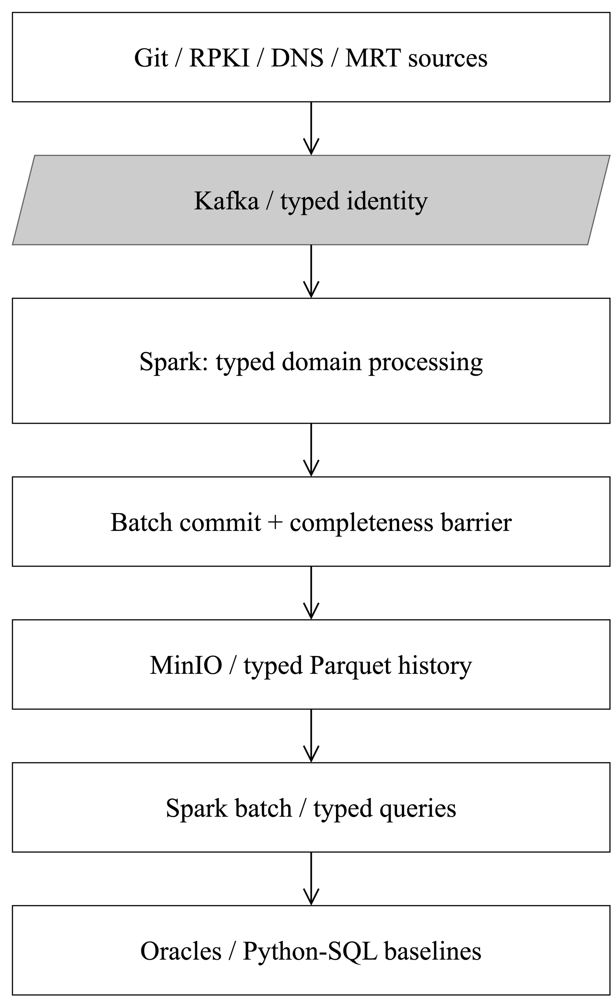

# Phase 15 — authoritative research freeze v1

## FINAL PHASE 15 DECISION

**METHOD FROZEN — FOUR-DATASET ROADMAP CONDITIONAL**

Four roles are methodologically justified, but instructor/budget, new typed lake
registration, independent occurrence/observation oracles and legal publication
gates remain open. This approves **a design specification and gated roadmap**,
not all implementation, not instructor approval and not proven performance.
**Do not begin Phase 16 as part of this task.** Phase 14's reduced-scope decision
and Phase 12's configuration-history conclusion remain unchanged history.

Recommended academic title (no repository rename):
**ConfigStream: A Semantics-Aware Big Data Architecture for Infrastructure State
and Event History Analytics**. “Big Data architecture” identifies the system being
evaluated, not proof that each bounded input requires Spark or that a distributed
cluster has been evaluated. If course criteria require a production operational
application or horizontal scaling, this design is insufficient without new approval.

## Frozen method and claims

One problem: **preserve source-identifiable heterogeneous infrastructure evidence
under replay/failure without false equivalence, and measure historical storage,
reconstruction and processing costs against simpler batch approaches**.

Exactly three principal RQs: **RQ1 evidence-preservation correctness**, **RQ2
storage/reconstruction/query trade-offs**, **RQ3 workload-dependent local processing
cost and streaming utility**. Wording, hypotheses, variables and refutation:
[methodology](phase15-research-methodology.md). K1 typed preservation/recovery,
K2 measured cost trade-offs, K3 cross-domain applicability/limits are **prospective**
engineering/empirical contributions, not new algorithms or achieved results.

Freeze the four roles: Terraform accepted ordinal-version reference; RPKI complete
scoped policy-state observations; DNS uncertain measurement-derived observations;
RIS native occurrence ledger. Freeze taxonomy, common manifest-bound header and
typed identities, source precision/unknown handling, scope/completeness descriptors,
occurrence multiplicity, I1–I9, independent/qualified oracle policy, fairness,
primary metrics, lossless projection definitions, exclusions and milestone gates.

Authoritative supporting documents (distinct responsibilities):
- [Methodology](phase15-research-methodology.md): problem, roles, three RQs, prior work/claims.
- [Semantic contracts](phase15-semantic-contracts.md): paper identities/payloads, time/completeness/dedup.
- [Correctness invariants](phase15-correctness-invariants.md): failures, oracles and hard tests.
- [Experiments](phase15-experimental-design.md): representations, baselines, thresholds/units.
- [Expansion/feasibility](phase15-data-expansion-and-feasibility.md): windows, resource/effort/legal gates.

Controlled amendments require dated decision ID, old/new rule, verified reason,
affected inputs/claims, expected test impact and approval before new measurements.
Allowed reasons: real schema/parser limitations, newly verified license constraints,
correctness defects and measured resources. Do not silently change thresholds,
counting policy, input selection or RQs after favorable/unfavorable outcomes.
Original Phase 10–14 results never get overwritten to match the new method.

## Architecture frozen on paper

Select **shared temporal contracts + typed processors + common publication,
recovery and evaluation**, not forced ConfigSnapshot adapters and not unrelated
pipelines sharing only a lake. Separate typed queries/checkpoints are allowed;
there is no universal version/state/event machine.

Figure 2. Planned boundaries, not new deployed components. Raw inputs remain
private and immutable; a manifest-bound header connects domain-specific processors
to shared publication/validation. Editable [draw.io source](figures/phase15-architecture.drawio).

Ingestion validates source contracts and delivery identity; typed processors own
configuration ordinals, complete policy sets, qualified DNS observations or routing
occurrences. Committed batch publication remains the common infrastructure;
state completion descriptors are an additional analytical barrier. Frozen-input
historical reads and independent ledgers govern acceptance. Error ledgers are
first-class safe metadata; raw source content is never a log/API payload.

Actual reuse: Kafka client/backpressure patterns, Spark runtime/checkpoints,
MinIO conditional manifests, safe logging, manifest-frozen analytical runs,
environment/progress sampling and original Terraform tests. Required future
additions: explicit serializer/reader registration, typed private schemas, logical
identity reconciliation, completion descriptors, domain parsers/processors/oracles,
typed analytical queries and occurrence-aware measurements. The current transport
union, SQL parser, per-asset VersionProcessor, text ConfigDiff, router rules,
lake dataset allowlists, configuration analytics and search/API models **cannot
just accept** RIS/RPKI/DNS. Do not modify old semantics to force reuse.

Existing batch commit UUID/count/path checks are useful but do not enforce full
logical-payload equality or complete daily sets. No Kafka/MinIO/Elasticsearch
cross-system exactly-once transaction, multiwriter lake or automatic state migration
is claimed. New-domain registries must be additive with old readers preserved.

## Table I — hard approval gates

PASS is paper-design readiness only, not implemented acceptance.

| Gate | Current result | Evidence / missing evidence | Required action and failure consequence |
|---|---|---|---|
| A method coherence | PASS (design), instructor CONDITIONAL | One problem/three falsifiable RQs; DNS is uncertainty counterexample, not second policy monitor | Instructor accepts systems evaluation and negative outcomes; rejection stops whole expansion |
| B semantic correctness | PASS (specification) | Typed identity/completeness/unknowns, no false ConfigDiff/events | Phase 16 owned fixture proof required; unfixable universal-model conflict stops affected path or entire shared claim |
| C ground truth | CONDITIONAL | Existing Terraform oracle; RPKI/DNS independent implementations and RIS coordinate/expansion ledger not built | Resolve all essential ID/oracle claims before integration; causal DNS oracle unavailable by design; RIS parser failures must stay explicit |
| D compatibility | CONDITIONAL | Actual closed transport/state/lake contracts inspected | Additive registration/recovery tests preserve old results; any unfixable regression blocks new infrastructure |
| E data/legal access | CONDITIONAL | Existing private cache/URLs/hashes; raw-publication rights unresolved, DNS terms explicit | Verify applicable research/attribution terms and future publication notices; illegal use stops affected source, mandatory raw-public demo without rights stops project plan |
| F fair evaluation | PASS (design) | Matched input/projection/resources, batch baselines, preregistered thresholds, negative acceptance | Implement baselines/oracles; if only counts/demo remain, no claimed research contribution |
| G resource feasibility | CONDITIONAL | 180/318/574 h estimates; local guards; no actual team-hour commitment/container allocation | Approve labor budget and small-window byte/RSS pilot; stop enlargement or reduce domains before unsafe run |
| H scope discipline | PASS (freeze), conditional execution | Exactly four roles and three RQs, no domain product | Any need for causal attribution/RIB/ROV/API/cluster triggers separate approval, not hidden feature work |

Fatal common-method/instructor/old-history corruption failures stop expansion.
DNS comparability/legal/resource failure may postpone DNS, but K3/four-role claims
must be amended to **reduced implementation**, not marked complete. Failed cost or
capacity hypotheses are legitimate findings, not reasons to discard empirical data.

## Implementation roadmap — future only

Early DNS schema qualification and RIS coordinate feasibility move into Phase 16
**offline contract tests**, avoiding late discovery of an essential gate. No DNS
adapter or MRT production importer is authorized in that phase. Remaining order
16→17→18→19→20→21 is sensible: RPKI establishes observation barriers, RIS tests
distinct occurrence semantics, DNS tests observation uncertainty against those
shared principles, then cross-workload evaluation/reporting.

| Phase | Deliverables / prerequisites | Independent acceptance / evidence | Stop before next expensive step |
|---|---|---|---|
| 16 contracts/infrastructure | W0,W1,W2,W3; approved scope/legal/time; owned typed fixtures, identity specs, additive publication registration | I1–I9 fixtures applicable offline; offset/index proof including malformed record; DNS missing/empty/precision distinctions; old manifests/schemas/tests preserved; no real adapter | Unresolved coordinate/collision/completeness or approval/budget; do not start services/source work |
| 17 RPKI | W4,W5; independent source set oracle, 14 frozen days | Exact complete sets/digests, 13 boundaries/12,016 tuples, no partial/gap transitions, restart visible-history tests | Any mismatch: repair/timebox or stop, no larger windows |
| 18 RIS | W6,W7,W12; pinned framed ledger/expansion/error policy, 5→15→60 min | Exact occurrence map/multiplicity, 57-error reference accounting, repeat fingerprints kept, replay/restart and byte/RSS measured | Lost occurrences/unsupported unexplained framing/resource breach: stop expansion/capacity claims |
| 19 DNS generalization | W8,W9; terms and uncertainty model, two frozen partitions | E4 exact qualified observations, no false deletions/causal edits, reuse retains time/status/source evidence | If merely IP-change counting or incomplete knowledge is treated as absence: postpone DNS and revise K3 |
| 20 empirical comparison | W10,W11,W13; all retained-kind oracles pass | E1–E4, matched baselines, storage/query preference and load targets; failed runs retained; expansion separately approved | No correctness/budget/fair baseline: stop enlargement; publish valid negative limits |
| 21 synthesis/regression | W14,W15 | Claim-evidence audit, independent reproduction, old/new regressions/CI, instructor-ready limits | Unproved claims cannot enter final conclusions; no completion before checks |

Minimum coherent increment remains RPKI+RIS with Terraform reference; DNS is
mandatory **to test the full four-role methodology claim**, not to operate that
smaller system. It may not consume correctness/baseline budget merely to complete
a checklist. A one-developer four-role plan costs 318 expected person-hours; no
deadline is inferred. Stop at validated reduced scope if approved time is insufficient.

## Red-team: unresolved risks and reduction triggers

| Objection | Severity / evidence; fatal? | Mitigation / residual risk / scope trigger |
|---|---|---|
| DNS duplicates another RPKI scope | High; both daily, but partition ≠ entity completeness in DNS; fatal if E4 adds no distinct test | E4 negative missing/status/vantage suite; moderate residual; drop DNS if only state counts remain |
| RIS turns topic into telemetry | High; native occurrences, not configs; not fatal to historical preservation | Occurrence/storage/recovery only, no detectors; trigger new scope if incident analytics is required |
| Provenance/publication alone is trivial | High; existing event sourcing/lakes; fatal to novelty-by-envelope | Exact ID/coverage/recovery counterexamples and cost baselines; residual empirical, not algorithm novelty |
| Terraform no longer relevant | Medium; only existing implementation | Reference ordinal semantics differs from daily/event evidence; no new mining; omit speed comparison, not its evidence role |
| Three RQs cannot connect four datasets | High if each source becomes a product | E1 common invariants, E2 within-kind costs, E3 workload shape, E4 limits; stop if unrelated domain questions required |
| Units incomparable | High, fatal to pooled event totals | Matched within-domain projection, unit-labelled costs and N/A; no four-source rate ranking |
| Kafka/Spark unnecessary for daily inputs | High, likely plausible at bounded scale, not fatal to evaluation | Simple batch and optional local SQL; negative streaming result accepted; no necessity claim |
| Batch comparison unfair | High, fatal to superiority claim | Same inputs/query/policy, startup/cache/resource accounting; register exceptions before runs |
| Domain logic dominates engineering | High; current processors closed/config-specific | Budget 318 h, phase stops, reuse only sound infrastructure; postpone DNS rather than cut tests |
| Novelty collapses into integration | High; prior work already exists | K1–K3 independent tests plus measured trade-offs; instructor approval; retain old evaluation if no meaningful result |
| Contributions not separately testable | Medium | K1 identity/recovery, K2 bytes/query/cost, K3 DNS negative control; publish failed hypotheses, not five proven features |
| Resources/legal limits prevent four roles | High; estimates not commitments, redistribution unresolved | Cached windows/private data/owned fixtures, actual guards; failed legal/budget gate reduces or stops scope |

Most plausible failure: four domain-specific adapters consume time while exact
oracles and fair baselines are left unfinished. Early warning is adapter demos
without identity ledgers. Detect at Phase 16/17 acceptance; do not authorize RIS/DNS
expansion until oracles and publication tests pass. Other pre-mortem triggers:
partial-state removals (I4 fixtures), RIS multiplicity loss (I3 fixture), raw-public
demo required without rights (E gate), and unsupported throughput from branch metrics
(W12 accounting). Fall back to the last validated scope, never inflate input/claims.

## Instructor approval questions

1. Is one semantics-aware preservation/cost problem across four evidence kinds
   accepted, rather than a domain-specific operational monitoring product?
2. Are local real-input systems experiments with exact oracles and strong batch
   baselines sufficient, including negative performance/storage findings?
3. Is one bounded natural high-velocity RIS source acceptable alongside daily
   observations and sparse Git history, without a multi-worker cluster claim?
4. Can raw sources remain private/re-downloadable with safe aggregate results
   and owned fixtures public, under attribution/redistribution conditions?
5. What person-hour budget is actually available, and may DNS/larger windows be
   postponed when their gates fail rather than weakening correctness?

## Vietnamese executive explanation

**Đóng băng phương pháp bốn vai trò, nhưng roadmap còn điều kiện.** History cấu
hình thực vẫn thưa: Terraform có 10.188 revision, 6.505 file incarnation và
12.278.085 byte; 77,48% chỉ một version. RPKI bổ sung trạng thái authorization
được quan sát; DNS kiểm tra trường hợp dữ liệu đo có bất định; RIS bổ sung các
lần xuất hiện sự kiện định tuyến có multiplicity và burst thực. Không cộng bốn
loại record thành “thay đổi cấu hình”, không xem commit là deployment hay DNS
khác IP là sửa zone đã được xác nhận.

Một bài toán chung là **giữ đúng bằng chứng lịch sử có provenance, kiểm tra
replay/recovery và đo chi phí lưu trữ–khôi phục–xử lý so với batch đơn giản**.
Ba RQ là correctness, storage/reconstruction và processing cost. DNS có giá trị
khi chứng minh partition đầy đủ không đồng nghĩa biết đầy đủ trạng thái từng
query; thiếu đo/timeout không được suy thành deletion. RIS phải giữ những lần
xuất hiện khác nhau dù payload giống nhau; RPKI chỉ diff hai state đầy đủ, liên
tiếp và so sánh được. Big Data velocity thực đã quan sát nằm ở RIS, không phải
tần suất sửa file; throughput hệ thống mới chưa được đo.

Ước lượng triển khai **180–574 giờ công, kỳ vọng 318 giờ**, không phải thời gian
đã đo. Cần giảng viên chấp nhận hướng đánh giá hệ thống/local và kết quả âm,
chốt budget, quyền dùng/công bố dữ liệu và oracle độc lập trước khi coding.
Phase 16 chỉ làm contract/infrastructure và fixture correctness; chưa adapter
RPKI/RIS/DNS. Nếu DNS hoặc budget không đạt gate, giữ phạm vi đã kiểm chứng và
điều chỉnh claim, không ép làm bốn demo cho đủ nguồn.

## Validation record

Phase 15 changes only these six documents, compact research JSON and two academic
figures. No production/test code, dependency, old measurement or old conclusion
changes. Offline JSON/link/hash/arithmetic checks and existing service-free
regressions are recorded in `methodology-decision.json` after execution. No new
service integration, source download, adapter or benchmark is claimed. The exact
review commit and its completed CI are reported in the final handoff; CI for an
earlier commit is not substituted for it.

Local checks on 2026-10-12: `make check` passed lint/format and **823 unit tests**
(12.81 s); `make api-test` passed **80** (0.61 s, one existing Starlette/httpx
deprecation warning); `make spark-test` passed **60** service-free transformations
(48.48 s). No new tests or service integrations were added. Ephemeral standard-library
validation checked all 11 JSON files, reference IDs, three RQs/four roles/nine
invariants, pinned original hashes/counts, local links, package sum 180/318/574,
188-hour dependency path and disk-scenario arithmetic. It added no dependencies.

Both figures were authored YAML-first with the draw.io academic CLI, validated
and exported through the installed Desktop application, then inspected visually.
PNG, editable draw.io and SVG are provided; the **IEEE Black and White** palette
is colorblind/grayscale safe. No label overflow or crossings remained; only the
CLI's informational >14-character label notices remained. Canonical work-sidecars
are in ignored `.cache/phase15-diagrams/`; the committed editable figures can be
re-exported with draw.io Desktop (`--export --format png --scale 3.125`) or imported
by the skill CLI. The conceptual figures are not claimed as deployed architecture.
