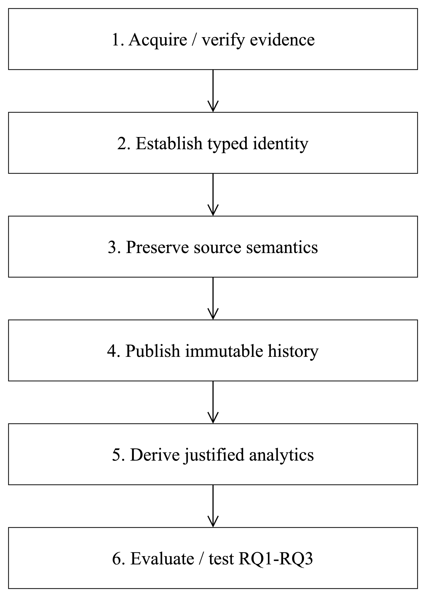

# Phase 15 — semantics-aware historical evidence methodology

Design freeze v1, 2026-10-12; inspected clean `main` at
`5409bf13c305dbb0a3d0c6b8b50d648e52dfc257`. This is a research blueprint,
not an implemented four-source system. The authoritative decision is
[research freeze](phase15-research-freeze.md). Phase 12's architecture-evaluation
conclusion and Phase 14's **GO — REDUCED SCOPE** remain historical decisions.
The owner's new four-role objective changes the proposal, not the evidence or
instructor approval. Outline: problem → roles → three questions → method → claims.

## One central problem

**How can a shared historical-data architecture preserve source-identifiable
infrastructure evidence under replay and failure, without confusing versions,
complete states, uncertain measurements and event occurrences, and at what
storage, reconstruction and processing cost relative to simpler batch methods?**

Target users are infrastructure-history researchers and audit analysts who need
reproducible answers about what a source reported, not inferred deployments or
incidents. Equal content may mean an unchanged observed state, a retry of one
record, or a second legitimate routing occurrence. Treating these identically
can erase evidence. Partial daily inputs can fabricate removals. A historical
answer is therefore meaningful only with identity, coverage, comparison policy
and provenance. Git, a DNS resolver and a routing collector are not interchangeable
truth sources.

The shared problem is **auditable preservation and cost of temporal evidence**,
not use of four tools or a causal relationship between four networks. Kafka
provides controlled delivery/replay/backpressure experiments; Spark supplies
typed batch/stream processing; immutable object storage supplies analytical
history. These capabilities are evaluated, not assumed necessary or superior.
The bounded daily datasets fit simple batch processing. Local experiments cannot
demonstrate distributed horizontal scalability or production exactly-once service.

## Table A — four distinct research roles

All counts are unchanged observations from the linked original JSON, not Phase 15
measurements. Hashes and exact units are pinned in
[dataset-role-matrix.json](../workloads/results/phase15/dataset-role-matrix.json).

| Dataset / evidence | Natural semantics and measured window | Unique methodological test | RQs | Limits |
|---|---|---|---|---|
| [Terraform](../workloads/results/terrads/history-summary.json), VersionedConfiguration | 375 accepted repos, 6,505 incarnations, 10,188 versions, 3,683 adjacent pairs; 12,278,085 UTF-8 bytes | Ordinal adjacency despite committer-time ties/inversions; existing reference correctness | 1; reference for 2/3, not matched speed control | 77.48% single-version; accepted public/licensed/security-filtered Git, not deployment history |
| [RPKI](../workloads/results/dataset-feasibility/rpki.json), complete scoped StateObservation | `ripencc.tal`, Sep 1–14 2026; 5,062,923 repeated tuples, 12,016 additions/removals; 909,372,097 CSV bytes | Complete-set barrier, exact membership reconstruction, observation redundancy | 1, 2, 3 | One validator/anchor scope, daily censoring; not administrator actions |
| [DNS](../workloads/results/dataset-feasibility/dns.json), MeasurementObservation | `.li`, Sep 1–2 2026; 2,234,863 rows; 4,091 changed of 144,883 common successful address groups; 252,307,526 uncompressed column bytes | Negative/generalization test: preserve uncertainty and absence without inventing deletion or causal labels | 1, 2; batch/stream overhead in 3 | A complete partition is not a complete authoritative zone; two days, changing resolver/response conditions |
| [RIS](../workloads/results/dataset-feasibility/bgp.json), EventOccurrence | `rrc00`, Sep 1 2026 00:00–01:00 UTC; 4,725,156 peer-prefix occurrences, 427,068,595 MRT bytes | Distinct equal-looking occurrences, expansion/error identity, genuine bursts | 1, 3; lossless log versus analytical projection in 2 | 57 parser exclusions, 118,172 equal-looking fingerprints retained; no RIB/state reconstruction |

The full TerraDS static population (1,513,378 `.tf` files,
2,601,501,820 logical bytes) is **context**, not observed change history:
[static summary](../workloads/results/terrads/static-summary.json).
RIS source-time mean is 1,312.543333 occurrences/s and peak is 181,868/minute;
neither is achieved ConfigStream capacity. Do not sum these incompatible units.

## Table D — exactly three principal questions

| RQ / hypothesis | Independent variables | Dependent variables | Datasets / baselines | Acceptance and refutation |
|---|---|---|---|---|
| **RQ1: Can typed identity, coverage and publication contracts preserve declared evidence under retry, disorder and partial failure?** H1: clean and perturbed runs have identical accepted logical histories under the declared failure model. | Redelivery, distinct equal payloads, order/ties, missing/partial observation, failure placement, checkpoint reuse | Missing/extra ID multisets, content/set checksums, false gap edges, exclusion ledger, recovery result | All four; independent source oracle; naive payload-dedup as a deliberately unsafe fixture control | Zero unexplained mismatch; correct partial/gap quarantine. One lost legitimate occurrence, fabricated removal or committed partial state refutes H1. No tolerance hidden in aggregates. |
| **RQ2: How do lossless historical representations trade storage against exact reconstruction and query cost?** H2: at least one state representation meets the predeclared preference rule; null H0: none does. | Full/canonical/reused state, delta/checkpoint interval, file layout; same within-domain input | Analytical/all-in bytes, file/manifests, exact reconstruction, median query/reconstruction time, memory, recovery cost | RPKI and DNS principal; Terraform existing contents/diffs reference; RIS occurrence log versus equivalent column projection (aggregates separately lossy); full append-only baseline | Exactness is mandatory; candidate preference requires ≥20% analytical byte saving and ≤2× median reconstruction/query time for every registered required query. Failure rejects preference, not the study. Report all-in costs even if they eliminate savings. |
| **RQ3: How do real workload shape and delivery policy affect local processing cost and the utility of streaming versus batch?** H3: streaming preserves evidence at a declared RIS 1× physical replay target within limits; null capacity claim is failure to do so. No hypothesis of universal speed superiority. | Nested source windows, preserved bursts/uniform pacing, physical rate 0.5/1/2×, processing mode, repeated-state density | Unique accepted rate, final/peak lag, end-to-end time, batch latency, RSS/CPU/checkpoint bytes, startup/recovery cost | RIS principal; daily RPKI/DNS overhead contrast; Terraform unchanged reference; Python/Parquet, Spark batch, Kafka–Spark | Exactness first; at 1×, final lag zero, no unexplained drops, no resource breach, drain ≤10% publishing duration. Saturation is a valid negative. Batch wins must be reported. |

Correctness is a deterministic contract test, not a statistical significance
claim. Cost comparisons use repeated paired measurements; three repetitions per
configuration are a minimum descriptive sample, not evidence of generality.
No new fourth RQ is introduced for DNS. Its role tests the limits of RQ1 and RQ2.
Experiments and denominators are frozen in [experimental design](phase15-experimental-design.md).

Confounders: parser/canonicalizer version, filtered population, cache temperature,
query projection, host load, serialization, Kafka partitioning, startup amortization,
source coverage, and source timing versus ingestion timing. Terraform's versions
are not time-order labels; daily state changes are interval-censored; RIS is a
collector's occurrence log. No cross-domain record-rate league table is valid.

## Six-step method: Semantics-Aware Temporal Evidence Preservation

1. **Acquire and verify:** freeze URLs, hashes, selection, license, scope and errors.
2. **Establish typed identity:** distinguish a version, observation, transition and occurrence.
3. **Preserve semantics:** validate completeness, comparability, uncertainty, ordering and multiplicity.
4. **Publish immutable history:** referenced private raw inputs, committed typed outputs, recovery/accounting.
5. **Derive justified analytics:** reconstruct sampled states or analyze occurrences; never invent causality.
6. **Evaluate:** independent or qualified oracles, matched simple baselines, costs and negative findings.

Figure 1. Six study steps, not six new production subsystems. Semantic contracts
and invariants are the controls; the datasets supply contrasting evidence.
Editable [draw.io source](figures/phase15-methodology.drawio).

These five shared concerns—identity/provenance, temporal meaning, typed history,
publication/recovery, reproducible evaluation—are substantial **only when tested
together**. A generic envelope alone is not a contribution. Typed processors may
differ; common falsifiable invariants and matched evaluation establish unification,
not identical metric names or identical source code.

## Table G — claim-to-prior-work and contribution boundaries

| Proposed claim | Existing knowledge / primary source | What ConfigStream can add; evidence required | Classification / invalidation |
|---|---|---|---|
| C1 typed temporal evidence model | Akidau et al., 2015, [The Dataflow Model](https://research.google.com/pubs/archive/43864.pdf): event time, completeness/cost trade-offs; [Fowler, 2005](https://martinfowler.com/eaaDev/EventSourcing.html) describes event sourcing (practitioner pattern) | Bounded typed contracts validated by counterexamples across four evidence kinds; no universal state machine | Supporting engineering within consolidated K1; unsupported if only a document/envelope without acceptance tests |
| C3 replay/recovery correctness | Armbrust et al., 2018, [Structured Streaming](https://cs.stanford.edu/~matei/papers/2018/sigmod_structured_streaming.pdf), DOI 10.1145/3183713.3190664; Armbrust et al., 2020, [Delta Lake](https://www.vldb.org/pvldb/vol13/p3411-armbrust.pdf), DOI 10.14778/3415478.3415560 | Source-ledger and completeness tests at ConfigStream's actual manifest boundary, including negative/failed runs | Core engineering K1, not invention of exactly-once or an ACID table; invalidated by identity/recovery mismatches |
| C2 storage/reconstruction trade-offs | Event sourcing and columnar analytical systems are established; Raasveldt & Mühleisen, 2019, [DuckDB: an Embeddable Analytical Database](https://duckdb.org/pdf/SIGMOD2019-demo-duckdb.pdf) motivates a strong local analytical alternative | Within-domain, same-input measurements including raw retention, metadata and negative delta results | Empirical K2; unproved until exact queries/bytes measured; no new compression algorithm |
| C4 multi-workload cost evaluation | Orsini, King, Giordano, Giotsas & Dainotti, 2016, [BGPStream](https://bgpstream.caida.org/), DOI 10.1145/2987443.2987482; Bühler et al., 2026, [TerraDS v2](https://zenodo.org/records/20339474) already provide data/access methods | Real retained windows, per-unit denominators and local batch-versus-stream trade-offs | Empirical K2/K3, not new network telemetry or dataset invention; refuted superiority claims remain publishable |
| C5 limits under measurement uncertainty | van Rijswijk-Deij, Jonker, Sperotto & Pras, 2016, [large-scale active DNS measurements](https://doi.org/10.1109/JSAC.2016.2558918); Chung et al., 2019, [RPKI is coming of age](https://research.cloudflare.com/chung2019/), longitudinal policy/routing analysis | DNS missing/status/vantage-qualified observation tests versus RPKI complete-set barriers; never ground-truth authoritative-change labels | Empirical generalization K3, currently a hypothesis; unsupported if DNS merely counts IP changes or violates uncertainty contracts |

Consolidate into **three prospective contributions**: **K1** auditable typed
preservation/recovery (C1+C3); **K2** reproducible storage/query and processing
trade-offs (C2+C4); **K3** cross-domain applicability **and limits**, especially
measurement ambiguity (C5). None is a proven experimental result yet.
Novelty is modest engineering/empirical validation, not a new distributed algorithm,
temporal database, event-sourcing invention, network-security product or probability
model. Prior work already solves major pieces; student-project value depends on
reproducible counterexamples and meaningful comparisons, not integration alone.

## Self-review and threats to validity

- Contribution: are K1–K3 measured? **Not yet**; paper claims must remain prospective.
- Clarity: do four roles answer one problem? Yes by identity/coverage/recovery/cost, not causality.
- Experimental strength: can simple batch win? Yes; preferences are frozen before results.
- Completeness: are global histories or operator actions known? No; scope/source exclusions remain explicit.
- Method soundness: can DNS or RIS use the old version machine? No; typed contracts and qualified oracles are mandatory.

Public OSS filtering, one anchor/zone/collector, short windows, unknown measurement
conditions and parser dependence restrict generalization. In-domain expansion is
not global population inference. Instructor acceptance of local systems evaluation
and an explicit labor budget are still required.
